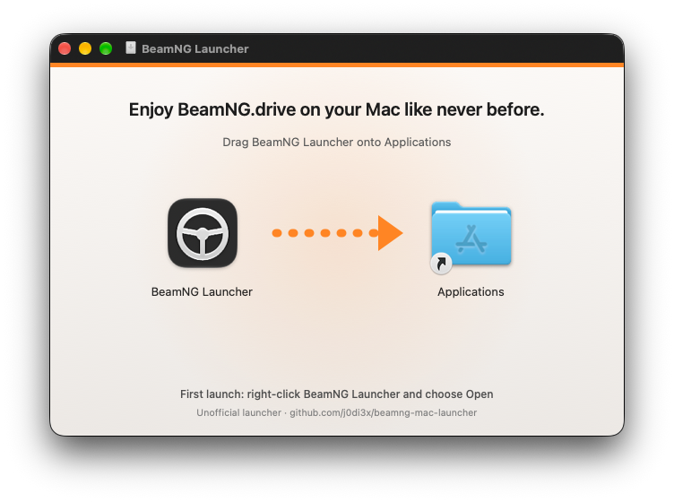
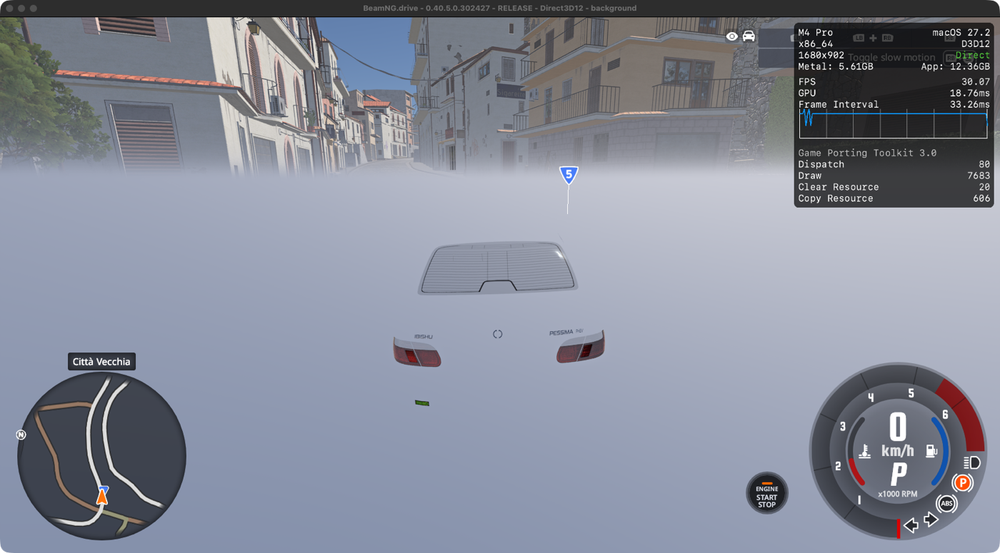

# BeamNG Launcher for Mac

A small, native macOS launcher that runs **BeamNG.drive** on Apple silicon through Wine and Apple's
**Game Porting Toolkit 4** (D3DMetal 4), with no GameHub window and no Steam needed to play.

<p align="center"></p>

> Unofficial. Not affiliated with BeamNG GmbH, Apple or GameHub. You need your own copy of BeamNG.drive.
> This repository contains no game files, no Wine build and no Apple software.

## Why

On macOS 27 the GameHub app ships an older D3DMetal (GPTK 3.0) that breaks parts of BeamNG 0.40:
fog covers the screen, shadows are missing or misplaced, and trees and objects disappear. The
launcher swaps in **GPTK 4** and applies the workarounds that are still needed, so the game renders
correctly.

| Problem on GameHub (GPTK 3) | With this launcher (GPTK 4) |
|---|---|
| Grey fog layer covers the road and car | Fog renders correctly |
| No shadows unless Metal 4 is forced | Shadows on by default (Metal 4) |
| Trees and objects missing (GPU-driven draws fail) | Drawn, via `-nogfxgpudriven` |
| Old DirectX 12 runtime, "outdated GPU driver" popup | Agility SDK runtime (`d3d12core`), no popup |
| Settings in two places | One window: presets, render scale, FPS, controllers |

See the [comparison](#gamehub-vs-launcher) below.

## Features

- **Play / Quit / Restart** with live game status
- **Graphics:** BeamNG's official presets (read from your game folder), window size, FPS counter (Metal HUD)
- **Advanced:** anti-aliasing (FSR 3 recommended), render scale, sharpness, shadows, meshes
- **Controllers:** shows a ✓ when a controller or steering wheel is connected (Xbox/PlayStation pads,
  Logitech, Thrustmaster, Fanatec, Moza, Simucube), plus what BeamNG detected last time
- **Compatibility switches:** missing-objects fix, Metal 4, optional fog-off mod, GPTK version picker
- **Tools:** clear shader caches, reset to recommended settings (with backup), choose game folder
- **Multiplayer:** one switch for [BeamMP](https://beammp.com). The launcher downloads the official
  BeamMP launcher from BeamMP's GitHub releases (checked against its published SHA-256) and starts it
  in the same Wine prefix before the game
- **Real-world maps (experimental):** [BeamNG.Earth](https://github.com/TecnaGamer/BeamNG.Earth) and
  [EarthNG](https://github.com/Alezx311/earthng), see [below](#real-world-maps-experimental)
- **Discord status:** friends see "Playing BeamNG.drive" with your map, car and play time, like on
  Windows (see [Discord](#discord-status))
- **13 languages:** the launcher itself and a game language picker, in every language BeamNG ships:
  English, Deutsch, Español (España), Español (Latinoamérica), Français, 日本語, 한국어, Polski,
  Português (Brasil), Português (Portugal), Русский, 简体中文, 繁體中文

Settings changed while the game is running are queued and applied when it closes, because BeamNG
rewrites its settings file on exit.

## Requirements

- Mac with Apple silicon, macOS 14 or newer (tested on macOS 27.2, M4 Pro)
- **BeamNG.drive** (Windows version) installed somewhere on your Mac, e.g. a Steam library folder
- **GameHub** installed, with any Windows game run in it once. The launcher imports GameHub's Wine
  runtime from there; it is not redistributed here.
- **Apple Game Porting Toolkit 4:** download *"Evaluation environment for Windows games 4.0"* from
  [developer.apple.com/download](https://developer.apple.com/download/all/?q=game%20porting%20toolkit)
  (free Apple ID). Apple's license doesn't allow redistributing it, so every user downloads their own.

## Install

### Download (easiest)

1. Get **BeamNG-Launcher-x.y.z.dmg** from the [latest release](https://github.com/j0di3x/beamng-mac-launcher/releases/latest).
2. Open it and drag **BeamNG Launcher** onto **Applications**.

   

3. The first time, **right-click the app → Open**. It isn't notarized by Apple, so a normal double-click is
   blocked once. If macOS still refuses, go to System Settings → Privacy & Security → **Open Anyway**.

### Build from source

Needs the Xcode command-line tools:

```bash
git clone <this repo>
cd beamng-mac-launcher
./build.sh --install
```

This puts **BeamNG Launcher.app** in `~/Applications`. `./make-dmg.sh` builds the release disk image
into `dist/`.

## First run

The launcher shows a setup checklist until all three are done:

1. **Wine runtime:** click **Import from GameHub**.
2. **Apple Game Porting Toolkit:** click **Install .dmg…** and pick the Apple download.
3. **BeamNG.drive folder:** found automatically in common places, or click **Choose…**.

Then press **Play**.

## How it works

Everything lives in `~/Library/Application Support/BeamNG-GPTK4/`:

```
containers/wine_installations/   Wine copied from GameHub (APFS clone, nearly no extra space)
containers/prefixes/beamng/      The Windows environment and your BeamNG user folder
gptk/<version>/                  D3DMetal from Apple's .dmg (current → active version)
addons/                          BeamMP launcher and BeamNG.Earth app, when you turn them on
launcher.conf                    Game folder, launch options, Metal 4, FPS HUD, BeamMP, BeamNG.Earth
bin/                             launch.sh, quit.sh, install-gptk.sh, setup-runtime.sh
```

`launch.sh` sets `WINEDLLPATH` and `WINE_GPTK_LIBD3DSHARED_PATH` to the chosen D3DMetal, `D3DM_MTL4=1`
for Metal 4 and `MTL_HUD_ENABLED=1` for the FPS counter, then starts `BeamNG.drive.exe` with
`-nogfxgpudriven`.

## Multiplayer (BeamMP)

Pick **Multiplayer (BeamMP)** in the Play box. The first time, the launcher downloads
`BeamMP-Launcher.exe` (about 8 MB) into `addons/beammp/`. On **Play** it starts that launcher with
`--no-launch`, waits until it is listening on port 4444, then starts the game as usual. In the game,
open **Multiplayer** and pick a server. BeamMP keeps itself up to date and is stopped when the game
closes. Its log is under the **…** menu next to the switch.

## Discord status

BeamNG has Discord Rich Presence built in, but under Wine the game can't reach the Discord app on the
Mac. The launcher fills in: while the game runs it reads the status line the game writes to its log
(for example *Playing Freeroam on West Coast Usa with Hirochi Accent*) and sends it to Discord through
Discord's local connection, under Discord's own BeamNG.drive app, so it shows as **Playing
BeamNG.drive** with the map, the car and the time played. Nothing is sent anywhere else. Turn it off
with **Show in Discord status** in the Play box.

## Real-world maps (experimental)

Two community projects let you drive real places. Both are early and have bugs; they are opt-in.

| | BeamNG.Earth | EarthNG |
|---|---|---|
| What | The whole planet at 1:1, streamed from elevation, satellite and OpenStreetMap data while you drive | Real towns built inside the game from OpenStreetMap, from map packs you download |
| How it runs | Its Windows world server runs next to the game in the same Wine prefix (started by the launcher) | A normal mod (`earthng_planet.zip`) plus one or more `earthng_<country>.zip` packs; no extra app |
| Download | ~90 MB app; map data streams from the internet | ~280 MB mod + a map pack (Albania 226 MB from GitHub, others from the project page) |
| In the game | Freeroam → **BeamNG.Earth** | Freeroam → **EarthNG - Planet** |
| Multiplayer | Has its own BeamMP servers (turn both on) | Not tested by its author |

BeamNG.Earth's server runs under Wine on Rosetta, so building new areas is slower than on Windows,
and its first visit to a place takes a while. It sends anonymous usage telemetry unless you turn
that off on its in-game welcome page. EarthNG's map builder (`EarthNG.exe`) needs Microsoft WebView2
and is not supported here; use ready-made packs (**…** menu → **Add map pack…**).

### Known issues

- **GPU-driven drawing** (`ExecuteIndirect` command signatures) still fails in D3DMetal 4.0 beta 3, so
  `-nogfxgpudriven` stays on. It costs some CPU-side performance in dense areas. Try turning it off
  in Advanced settings after each new GPTK release.
- Borderless fullscreen covers the Dock and menu bar under Wine; windowed mode is recommended.

## GameHub vs launcher

Same Mac (M4 Pro, macOS 27.2), same BeamNG 0.40.5 install, same spawn point (Italy, Città Vecchia,
loaded with `-level italy`), identical BeamNG settings files (High preset, FSR 3 at 100%, 1680×902
window) and `-nogfxgpudriven` on both. Only the runtime differs. The overlay is Apple's Metal HUD.

**GameHub: Game Porting Toolkit 3.0**



**BeamNG Launcher: Game Porting Toolkit 4.0 beta 3**


| | GameHub (GPTK 3.0) | Launcher (GPTK 4.0b3) |
|---|---|---|
| Fog | Grey layer covers everything below the horizon, car included | Correct |
| Shadows | Hidden under the fog layer | Car and buildings cast correct shadows |
| Graphics API (per Metal HUD) | D3D12 | D3D12 (Metal 4) |
| FPS / GPU time at this spot | 30 / 18.8 ms | 30 / 19.5 ms |

Frame rate was the same here; both runs sat at 30 FPS. The difference is what gets drawn correctly.
On GameHub the fog can be hidden with the bundled noFogFix mod, at the cost of losing all fog.

## Project layout

```
Sources/main.swift          The SwiftUI app
Resources/scripts/          Shell scripts the app installs into Application Support
Resources/*.lproj/          Translations, generated by Tools/l10n/build.py from Tools/l10n/<lang>.json
Resources/noFogFix/         Optional BeamNG mod that keeps fog at 0 (only needed on GPTK 3)
Resources/AppIcon.icns      App icon (generated by Tools/make-icon.swift)
Resources/dmg-background.tiff  Installer window background (Tools/make-dmg-background.swift)
build.sh                    Builds the .app
make-dmg.sh                 Builds the .app and packs it into dist/BeamNG-Launcher-<version>.dmg
```

## License

MIT, see [LICENSE](LICENSE). BeamNG.drive is a trademark of BeamNG GmbH. Game Porting Toolkit and
D3DMetal are Apple software under Apple's own license.

## Translations

The launcher uses English text as the key. To fix or add a translation, edit
`Tools/l10n/<lang>.json` and run `python3 Tools/l10n/build.py`. It checks that every string is
translated and that placeholders (`%@`, `%ld`) match. New strings in `Sources/main.swift` go through
`L("…")`.
