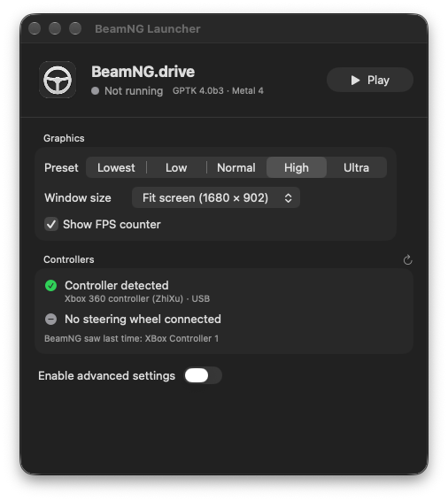
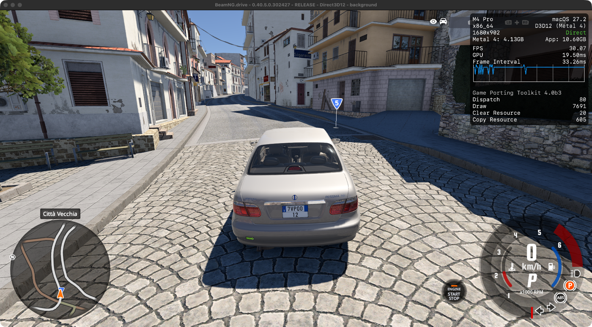

# BeamNG Launcher for Mac

A small, native macOS launcher that runs **BeamNG.drive** on Apple silicon through Wine and Apple's
**Game Porting Toolkit 4** (D3DMetal 4), with no GameHub window and no Steam needed to play.

<p align="center"></p>

> Unofficial. Not affiliated with BeamNG GmbH, Apple or GameHub. You need your own copy of BeamNG.drive.
> This repository contains no game files, no Wine build and no Apple software.

## Why

On macOS 27 the GameHub app ships an older D3DMetal (GPTK 3.0) that breaks parts of BeamNG 0.40:
fog covers the screen, shadows are missing or misplaced, and trees and objects disappear. The
launcher swaps in **GPTK 4** and applies the workarounds that are still needed, so the game renders
correctly.

| Problem on GameHub (GPTK 3) | With this launcher (GPTK 4) |
|---|---|
| Grey fog layer covers the road and car | Fog renders correctly |
| No shadows unless Metal 4 is forced | Shadows on by default (Metal 4) |
| Trees and objects missing (GPU-driven draws fail) | Drawn, via `-nogfxgpudriven` |
| Old DirectX 12 runtime, "outdated GPU driver" popup | Agility SDK runtime (`d3d12core`), no popup |
| Settings in two places | One window: presets, render scale, FPS, controllers |

See the [comparison](#gamehub-vs-launcher) below.

## Features

- **Play / Quit / Restart** with live game status
- **Graphics:** BeamNG's official presets (read from your game folder), window size, FPS counter (Metal HUD)
- **Advanced:** anti-aliasing (FSR 3 recommended), render scale, sharpness, shadows, meshes
- **Controllers:** shows a ✓ when a controller or steering wheel is connected (Xbox/PlayStation pads,
  Logitech, Thrustmaster, Fanatec, Moza, Simucube), plus what BeamNG detected last time
- **Compatibility switches:** missing-objects fix, Metal 4, optional fog-off mod, GPTK version picker
- **Tools:** clear shader caches, reset to recommended settings (with backup), choose game folder

Settings changed while the game is running are queued and applied when it closes, because BeamNG
rewrites its settings file on exit.

## Requirements

- Mac with Apple silicon, macOS 14 or newer (tested on macOS 27.2, M4 Pro)
- **BeamNG.drive** (Windows version) installed somewhere on your Mac, e.g. a Steam library folder
- **GameHub** installed, with any Windows game run in it once. The launcher imports GameHub's Wine
  runtime from there; it is not redistributed here.
- **Apple Game Porting Toolkit 4:** download *"Evaluation environment for Windows games 4.0"* from
  [developer.apple.com/download](https://developer.apple.com/download/all/?q=game%20porting%20toolkit)
  (free Apple ID). Apple's license doesn't allow redistributing it, so every user downloads their own.

## Install

Build from source (needs the Xcode command-line tools):

```bash
git clone <this repo>
cd beamng-mac-launcher
./build.sh --install
```

This puts **BeamNG Launcher.app** in `~/Applications`. If you got a prebuilt copy instead, macOS will
block it the first time because it isn't notarized: right-click the app → **Open**, or allow it in
System Settings → Privacy & Security.

## First run

The launcher shows a setup checklist until all three are done:

1. **Wine runtime:** click **Import from GameHub**.
2. **Apple Game Porting Toolkit:** click **Install .dmg…** and pick the Apple download.
3. **BeamNG.drive folder:** found automatically in common places, or click **Choose…**.

Then press **Play**.

## How it works

Everything lives in `~/Library/Application Support/BeamNG-GPTK4/`:

```
containers/wine_installations/   Wine copied from GameHub (APFS clone, nearly no extra space)
containers/prefixes/beamng/      The Windows environment and your BeamNG user folder
gptk/<version>/                  D3DMetal from Apple's .dmg (current → active version)
launcher.conf                    Game folder, launch options, Metal 4, FPS HUD
bin/                             launch.sh, quit.sh, install-gptk.sh, setup-runtime.sh
```

`launch.sh` sets `WINEDLLPATH` and `WINE_GPTK_LIBD3DSHARED_PATH` to the chosen D3DMetal, `D3DM_MTL4=1`
for Metal 4 and `MTL_HUD_ENABLED=1` for the FPS counter, then starts `BeamNG.drive.exe` with
`-nogfxgpudriven`.

### Known issues

- **GPU-driven drawing** (`ExecuteIndirect` command signatures) still fails in D3DMetal 4.0 beta 3, so
  `-nogfxgpudriven` stays on. It costs some CPU-side performance in dense areas. Try turning it off
  in Advanced settings after each new GPTK release.
- Borderless fullscreen covers the Dock and menu bar under Wine; windowed mode is recommended.

## GameHub vs launcher

Same Mac (M4 Pro, macOS 27.2), same BeamNG 0.40.5 install, same spawn point (Italy, Città Vecchia,
loaded with `-level italy`), identical BeamNG settings files (High preset, FSR 3 at 100%, 1680×902
window) and `-nogfxgpudriven` on both. Only the runtime differs. The overlay is Apple's Metal HUD.

**GameHub: Game Porting Toolkit 3.0**


**BeamNG Launcher: Game Porting Toolkit 4.0 beta 3**



| | GameHub (GPTK 3.0) | Launcher (GPTK 4.0b3) |
|---|---|---|
| Fog | Grey layer covers everything below the horizon, car included | Correct |
| Shadows | Hidden under the fog layer | Car and buildings cast correct shadows |
| Graphics API (per Metal HUD) | D3D12 | D3D12 (Metal 4) |
| FPS / GPU time at this spot | 30 / 18.8 ms | 30 / 19.5 ms |

Frame rate was the same here; both runs sat at 30 FPS. The difference is what gets drawn correctly.
On GameHub the fog can be hidden with the bundled noFogFix mod, at the cost of losing all fog.

## Project layout

```
Sources/main.swift          The SwiftUI app
Resources/scripts/          Shell scripts the app installs into Application Support
Resources/noFogFix/         Optional BeamNG mod that keeps fog at 0 (only needed on GPTK 3)
Resources/AppIcon.icns      App icon (generated by Tools/make-icon.swift)
build.sh                    Builds the .app
```

## License

MIT, see [LICENSE](LICENSE). BeamNG.drive is a trademark of BeamNG GmbH. Game Porting Toolkit and
D3DMetal are Apple software under Apple's own license.
